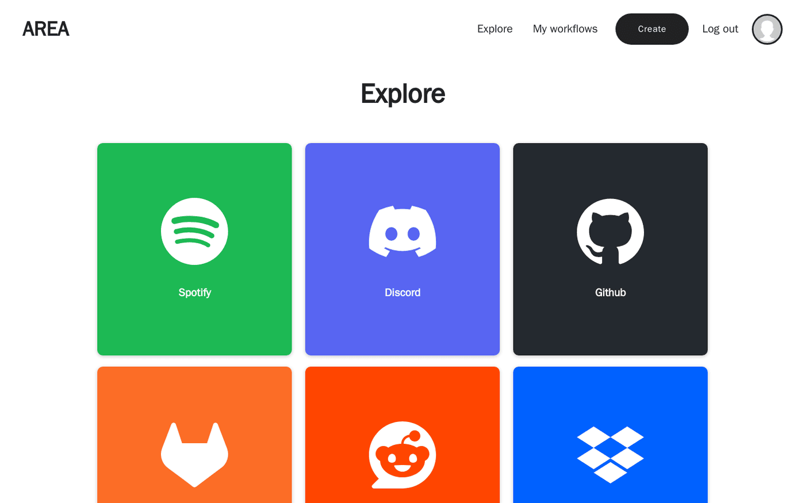
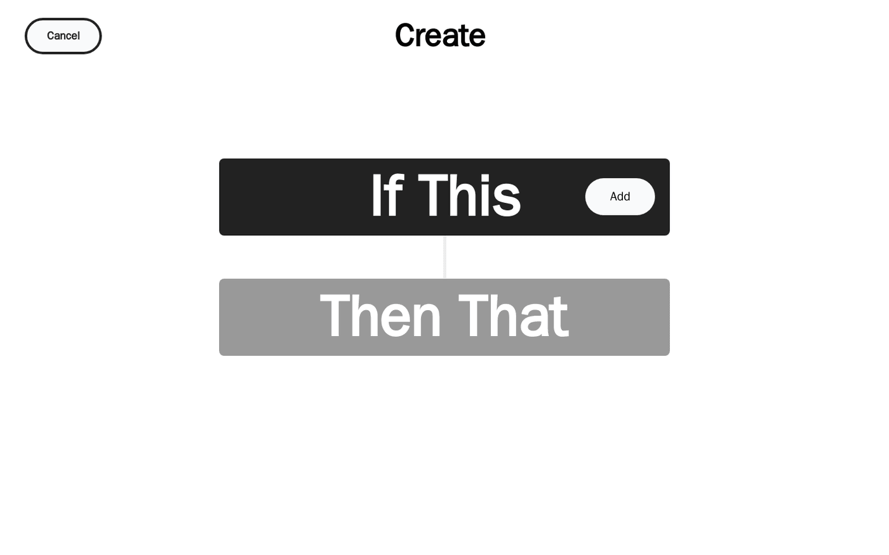
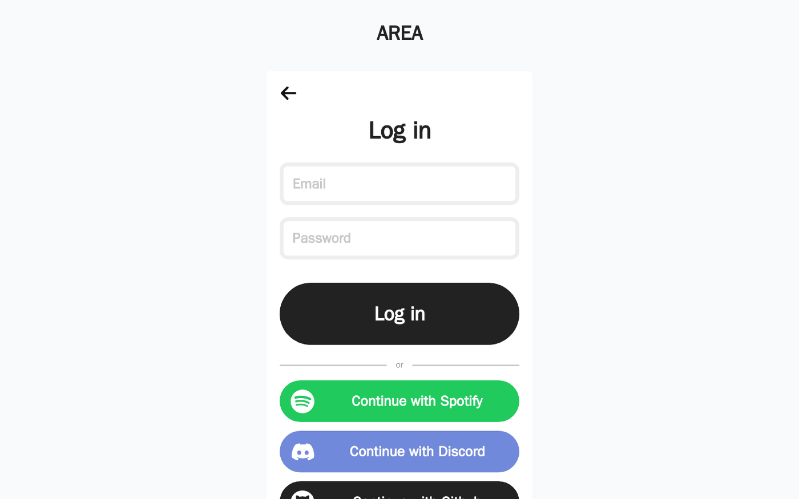

<div align="center">

# AREA

**Connecte tes applis entre elles : quand il se passe quelque chose ici, déclenche une action là-bas.**

         

<sub>Projet à 4 · 2024 – 2025</sub>

</div>

<br/>

<p align="center"></p>

## Le projet en quelques mots

Un clone de Zapier / IFTTT fait à quatre en deux mois. On connecte ses comptes (GitHub, Spotify, Discord…) et on crée des **workflows** : « quand une issue est ouverte sur GitHub, envoie un message sur Discord ». Un serveur en Go, un client web en React et une appli mobile en Flutter, le tout lancé avec Docker Compose.

## Ce que ça fait

- **Une quinzaine de services** : GitHub, GitLab, Spotify, Discord, Reddit, Dropbox, Asana, LinkedIn, Google, météo, minuteur, e-mail, SMS (Twilio)…
- **Connexion OAuth2** aux services, et aussi pour se connecter à l'app
- **Éditeur de workflows** : on choisit une action, une réaction, et les champs se remplissent selon le service
- Un client **web** et une appli **mobile** branchés sur la même API
- Doc développeur pour ajouter un service, une action ou une réaction

<p align="center"></p>
<p align="center"><sub>Création d'un workflow « If This, Then That »</sub></p>

<p align="center"></p>
<p align="center"><sub>Connexion avec OAuth2</sub></p>

## Lancer le projet

```bash
cp backend/.env.example backend/.env
docker compose up --build
```

La documentation technique complète est dans [DOCUMENTATION.md](DOCUMENTATION.md).

## L'équipe

<a href="https://github.com/Wilson-Epitech/area/graphs/contributors"></a>

Eva Legrand, Wilson Bordichon, Yanis Harkouk, Mathis Brehm

**Ma partition :** J'ai développé **le client web** : l'architecture React + TypeScript (migration du POC de Next.js vers Vite), l'éditeur de workflows et ses composants, les pages « Mes workflows », détail d'un workflow, Explore, services et connexion aux services, l'authentification (connexion, inscription, OAuth), le compte et le changement de mot de passe, la barre de navigation, les composants réutilisables, et la CI du frontend.
